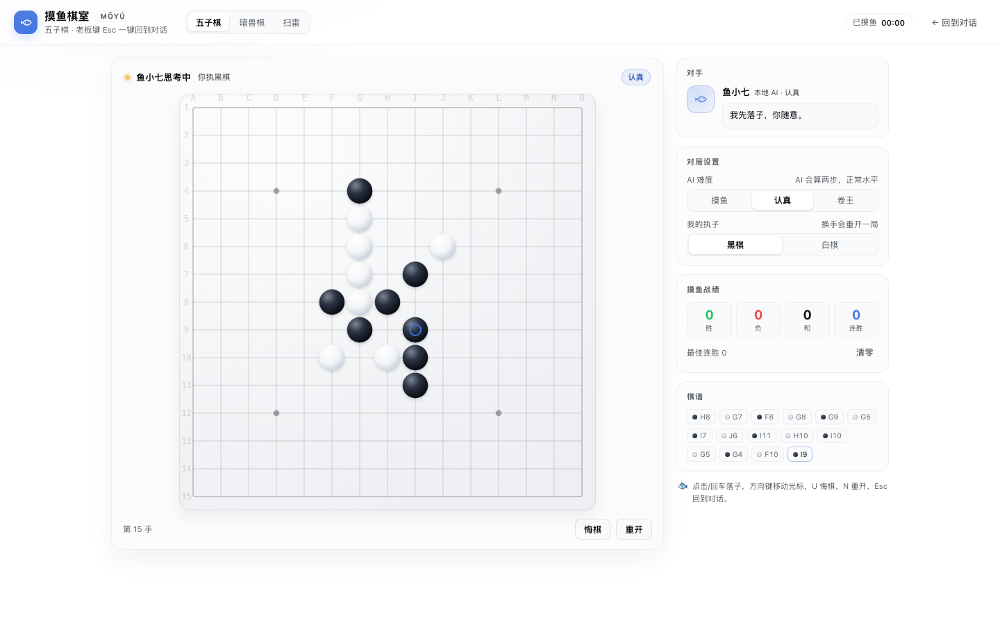
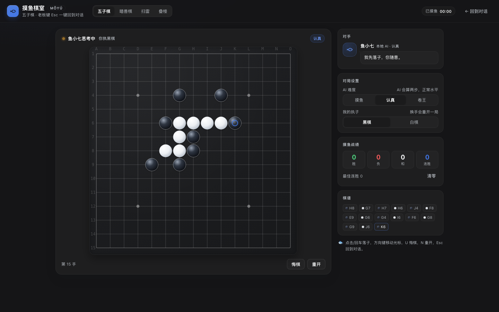
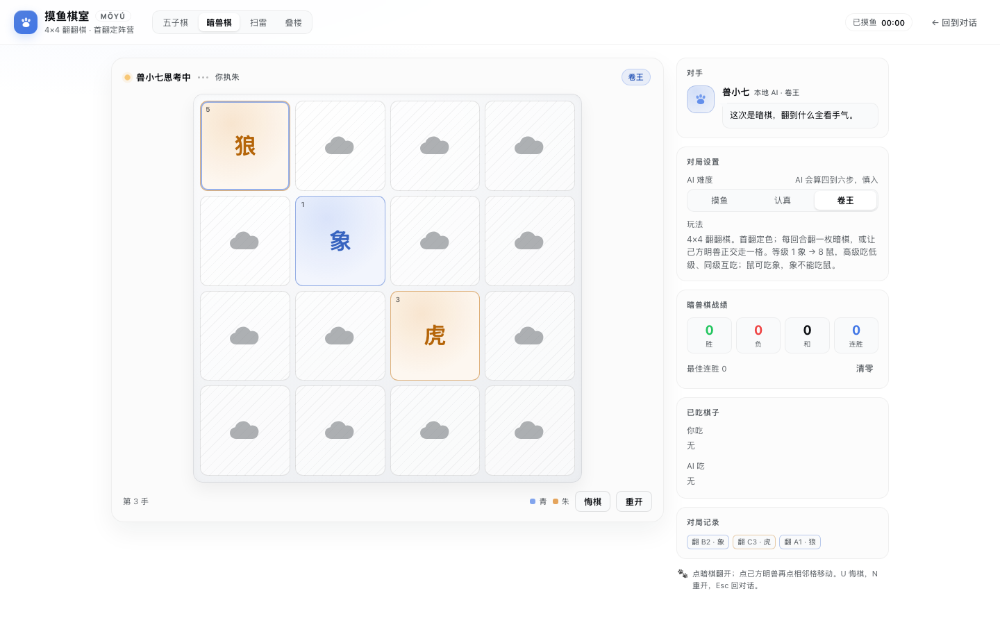
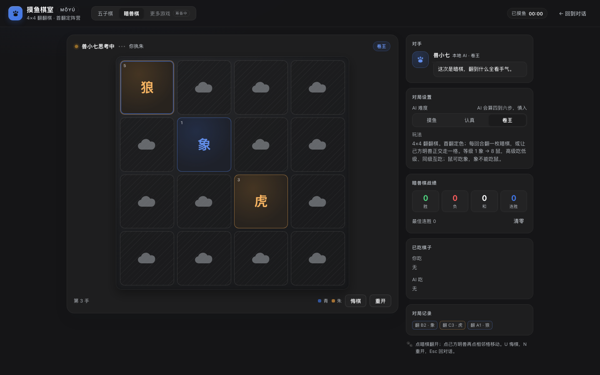

# dsh-moyu-games · 摸鱼棋室

> 一个给 DeepSeek Harness 用的「摸鱼」插件：侧栏点开，和本地 AI 下五子棋或暗兽棋。
> 老板来了按 **Esc**，立刻回到对话。









## 功能

- **五子棋**：15×15，无禁手，五连及以上即胜。
- **暗兽棋**：4×4 翻翻棋，16 枚棋子全部背面朝上；首翻定阵营，每回合翻一枚暗棋或走一格；
  等级 1 象 → 8 鼠，高级吃低级、同级互吃，鼠可吃象、象不能吃鼠。
- **本地 AI 对手「鱼小七」**：三档难度（摸鱼 / 认真 / 卷王），候选点棋形评分 + alpha-beta
  搜索；不调用大模型、不消耗 token、断网也能下。
- **老板键**：面板内按 `Esc` 或点「回到对话」立即切回聊天；输入框左侧还有一个「摸鱼棋室」小入口，随时开一局。
- **完整对局体验**：悔棋（自动带走 AI 应手）、重开、换手、落子预览、最后一手标记、胜利连线、
  棋谱、思考中状态、AI 吐槽。暗兽棋还包括翻棋预览、合法落点提示、吃子记录与规则速查。
- **分棋种战绩**：五子棋与暗兽棋各自记录胜负/和棋/连胜/最佳连胜，写入 Host 侧
  `$DSH_HOME/storages/moyu-games/stats.json`；Host 不可用时自动退回 `localStorage`。
- **刷新不丢局**：未结束的棋局会存到 `localStorage`，下次打开接着下。
- **自适应**：棋盘使用中性表面跟随系统外观 —— 浅色模式近白、深色模式近黑，不再使用木色；宽屏双栏、窄屏堆叠、键盘可操作（方向键 + 回车）。

## dsh-market

本仓库已按 [awesome-dsh-plugin](https://github.com/awesome-dsh-plugin/awesome-dsh-plugin) 的收录要求准备：

- `package.json` 同时声明 `dsh.bundle` 与 `dsh.client`，仓库根目录带 `cordis.patch.yml`
- 市场图标：`assets/icon-180.png`
- 商店截图：`screenshots.json`
- 待提交的条目文件：`market/KunChiang__dsh-moyu-games.yml`

## 安装

### 方式一：官方 CLI

```bash
dsh plugin --profile web add /absolute/path/to/dsh-moyu-games
```

### 方式二：DSH Desktop 的插件管理

在「设置 → 插件」里从本地路径安装（或让 Agent 通过 `plugin_manager` 的 `install_bundle`
指向本目录）。安装后刷新页面；若仍看不到入口，重启一次 Harness。

### 方式三：手动挂载

把本包链接进 profile 的 `node_modules`，再在 profile 的 `cordis.patch.yml` 末尾加：

```yaml
- insert:
    - id: moyu-games
      name: 'dsh-moyu-games'
```

## 使用

- 侧栏只有一个「摸鱼棋室」入口；打开后用顶部标签页在五子棋 / 暗兽棋之间切换。
- 五子棋：点棋盘交叉点落子；棋盘获得焦点后可用方向键移动光标、回车落子。
- 暗兽棋：点暗棋翻开；点己方明棋选中，再点高亮的相邻格移动或吃子。
- `U` 悔棋，`N` 重开，`Esc` 回对话。
- 难度与执子都在右侧「对局设置」里；换手会重开一局。
- 战绩卡片右下角「清零」只清战绩，不影响棋局。

## 开发

```bash
pnpm install     # 只装 esbuild
pnpm test        # 规则 / 状态机 / Host 路由 / AI 行为
pnpm build       # 生成 lib/index.js 与 lib/client.js
pnpm preview     # 生成 preview/panel-{light,dark}.html（视觉预览）
```

仓库结构：

```
src/shared/gomoku.js        五子棋规则 + 棋盘评估 + AI（纯函数，浏览器与 Node 共用）
src/shared/match.js         五子棋单局不可变状态机（落子、胜负、悔棋、存档恢复）
src/shared/dark-animals.js  暗兽棋规则 + 公开信息 AI（不偷看暗棋，纯函数）
src/host/index.js           Host 半：分棋种战绩 JSON 持久化 + /moyu-games/api/stats
src/client/index.jsx        Client 半入口：注册主面板 / 侧栏入口 / 输入框入口
src/client/Panel.jsx        共享外壳：品牌头、标签页、摸鱼计时、老板键
src/client/GomokuGame.jsx   五子棋对局 UI
src/client/DarkAnimalGame.jsx 暗兽棋对局 UI
src/client/Board.jsx        SVG 五子棋棋盘
src/client/DarkAnimalsBoard.jsx 4×4 暗兽棋棋盘
src/client/i18n.js          中英文案
src/client/styles.js        全部样式（注入 style[data-plugin]）
```

客户端通过 DSH 的 `window.__ModuleLoader__.load({ id, factory })` 协议加载，
只把 `react` / `react/jsx-runtime` 作为 external；样式用 `data-plugin` 标记，
便于 client-hmr 在重载时清理。

## 接口

Host 半只注册一个同源 JSON 路由：

```
GET  /moyu-games/api/stats?game=gomoku|dark-animals   -> { game, stats }
POST /moyu-games/api/stats          { game, result: "win" | "lose" | "draw" } -> { game, stats }
POST /moyu-games/api/stats          { game, reset: true } -> { game, stats }
```

数据文件：`$DSH_HOME/storages/moyu-games/stats.json`（原子写入）。

## 后续游戏

「更多游戏」标签页已经占位。新增游戏时建议沿用同样的分层：

1. `src/shared/<game>.js`：规则 + 本地 AI，保持零依赖、可单测；
2. `src/client/<Game>.jsx`：棋盘/界面，接收同一套「老板键 / 计时 / 战绩」框架；
3. 在 `Panel.jsx` 的游戏注册表里加一项，侧栏入口与 Host 战绩接口都不必改。

计划：四子棋、黑白棋、2048。

## 已知取舍

- AI 在主线程计算，五子棋卷王难度单步上限约 320 ms；对休闲对局够快，但极端长考时会有短暂卡顿。
- 暗兽棋首版采用基础 4×4 规则，不含豹/狗/鼠的特殊移动扩展；AI 只根据已翻开的棋子与暗格位置决策，不会偷看暗棋身份。
- 无禁手规则；不包含 Renju 黑棋禁手判定。
- 战绩按 Host 文件串行写入；多标签页同时结算存在极小概率后写覆盖先写。

## License

MIT